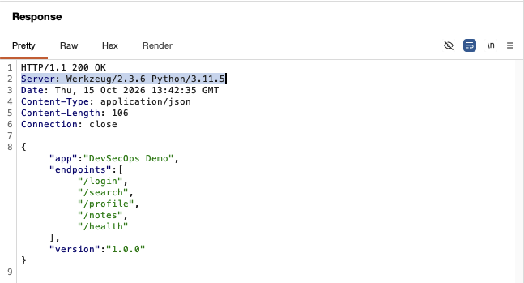

**Confirmed.** The server discloses the exact web framework (Werkzeug 2.3.6) and Python version (3.11.5) in every response. This gives an attacker precise version information to search for known CVEs. Combined with `debug=True` in the application code, this also exposes the Werkzeug interactive debugger, which allows remote code execution.



**Remediation:** Disable debug mode and suppress the server header.

```python
# Disable debug mode
app.run(debug=False)

# Use a production WSGI server that doesn't leak version info
# gunicorn --bind 127.0.0.1:8000 app:app
```

---

## Summary

| # | Finding | OWASP | CWE | Severity | Validated |
|---|---------|-------|-----|----------|-----------|
| 1 | SQL Injection | A03:2021 | CWE-89 | Critical | Payload returned all database records |
| 2 | Reflected XSS | A03:2021 | CWE-79 | High | Script tag rendered unescaped in response |
| 3 | Broken Access Control | A01:2021 | CWE-862 | High | Accessed other user's data without auth |
| 4 | Missing Security Headers | A05:2021 | CWE-693 | Medium | Zero security headers in any response |
| 5 | Server Info Leakage | A05:2021 | CWE-200 | Low | Framework and version exposed in every response |

## Why Manual Validation Matters

Automated DAST scanners flag potential vulnerabilities. Manual testing with Burp confirms exploitability with proof: the actual request that triggered it and the server's response showing the impact. This is the difference between "the scanner says this might be vulnerable" and "here is the injected payload and the data it returned."

In a consulting engagement, this evidence is what goes into the client deliverable. A confirmed finding with reproduction steps, screenshots, and remediation code samples is actionable. A scanner alert without validation is noise.