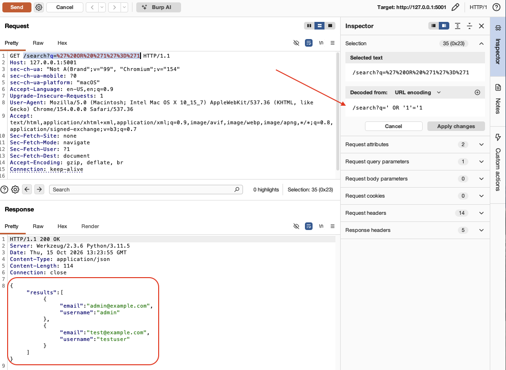
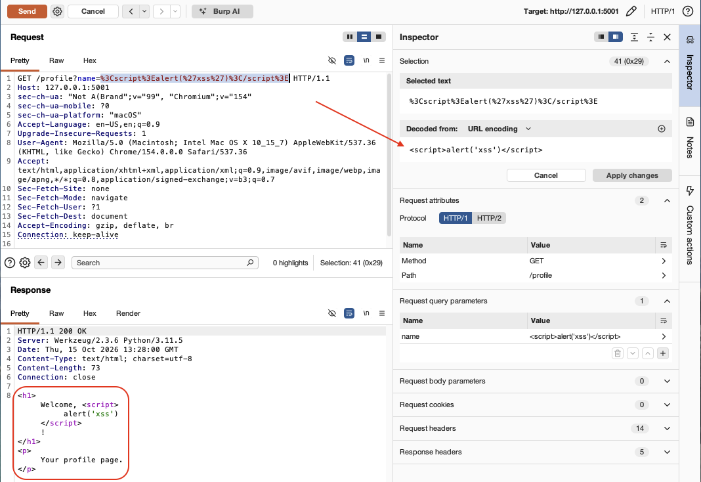
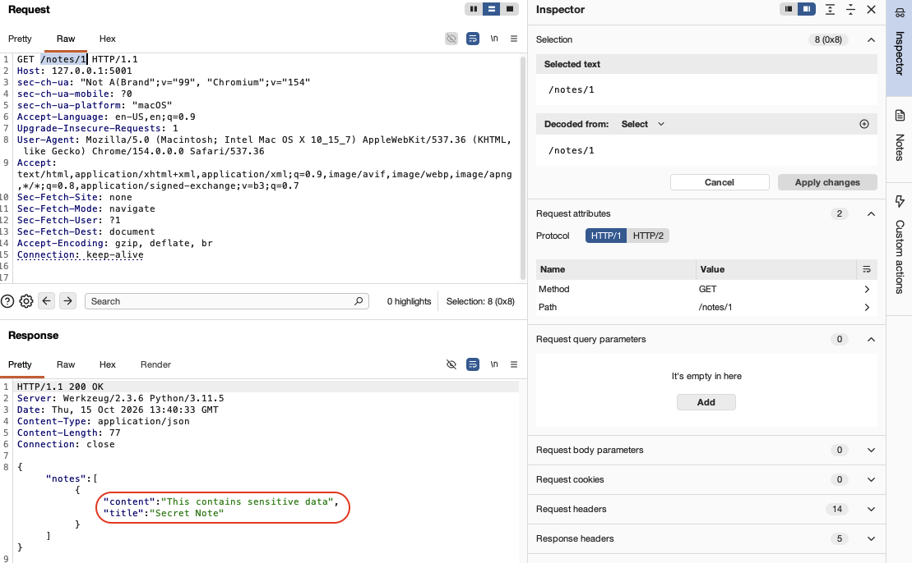
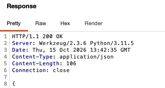

# Manual Validation with Burp Suite

Automated scanners (SAST, DAST) flag potential vulnerabilities. Manual validation with an intercepting proxy confirms whether they're exploitable. This walkthrough documents manual testing of findings flagged by the pipeline's automated scans.

## Setup

- **Target:** Intentionally vulnerable Flask app (`app/app.py`) running on `127.0.0.1:5001`
- **Proxy:** Burp Suite Community Edition, listening on `127.0.0.1:8080`
- **Method:** Captured baseline request in HTTP History, sent to Repeater, modified parameters, compared responses

---

## Finding 1: SQL Injection (CWE-89, OWASP A03)

**Endpoint:** `/search?q=`

**Baseline request:**

```
GET /search?q=test HTTP/1.1
Host: 127.0.0.1:5001
```

**Baseline response (1 result):**

```json
{"results":[{"email":"test@example.com","username":"testuser"}]}
```

**Injected request:**

```
GET /search?q=%27%20OR%20%271%27%3D%271 HTTP/1.1
Host: 127.0.0.1:5001
```

Decoded payload: `' OR '1'='1`

**Injected response (all records returned):**

```json
{"results":[{"email":"admin@example.com","username":"admin"},{"email":"test@example.com","username":"testuser"}]}
```

**Confirmed.** The injected payload bypassed the WHERE clause and returned every row in the users table. The application concatenates user input directly into the SQL query string without parameterization.



**Remediation:** Replace string concatenation with parameterized queries.

```python
# Vulnerable
query = "SELECT * FROM users WHERE username = '" + term + "'"

# Fixed
query = "SELECT * FROM users WHERE username = %s"
cursor.execute(query, (term,))
```

---

## Finding 2: Reflected XSS (CWE-79, OWASP A03)

**Endpoint:** `/profile?name=`

**Injected request:**

```
GET /profile?name=%3Cscript%3Ealert(%27xss%27)%3C/script%3E HTTP/1.1
Host: 127.0.0.1:5001
```

Decoded payload: `<script>alert('xss')</script>`

**Response (script rendered unescaped):**

```html
<h1>Welcome, <script>alert('xss')</script>!</h1><p>Your profile page.</p>
```

**Confirmed.** User input is rendered as raw HTML without encoding. The script tag is returned unescaped in the response body and would execute in a victim's browser, enabling session hijacking, phishing, or arbitrary actions on behalf of the user.



**Remediation:** Use a templating engine with auto-escaping.

```python
# Vulnerable
return render_template_string("<h1>Hello " + name + "</h1>")

# Fixed
return render_template("profile.html", name=name)
```

---

## Finding 3: Broken Access Control (CWE-862, OWASP A01 / API BOLA)

**Endpoint:** `/notes/<user_id>`

**Request:**

```
GET /notes/1 HTTP/1.1
Host: 127.0.0.1:5001
```

**Response (another user's private data returned):**

```json
{"notes":[{"content":"This contains sensitive data","title":"Secret Note"}]}
```

**Confirmed.** No authentication or authorization check. Any user (or unauthenticated attacker) can access any other user's notes by enumerating the user_id parameter. No session cookie, no auth token, no identity verification of any kind. This is BOLA (Broken Object Level Authorization), the #1 risk in the OWASP API Security Top 10.



**Remediation:** Require authentication and verify the requester owns the requested resource.

```python
# Vulnerable
@app.route("/notes/<user_id>")
def get_notes(user_id):
    notes = db.query("SELECT * FROM notes WHERE user_id = " + user_id)
    return jsonify(notes)

# Fixed
@app.route("/notes/<user_id>")
@login_required
def get_notes(user_id):
    if current_user.id != int(user_id):
        return "Forbidden", 403
    notes = db.query("SELECT * FROM notes WHERE user_id = %s", (user_id,))
    return jsonify(notes)
```

---

## Finding 4: Missing Security Headers (CWE-693, OWASP A05)

**Request:**

```
GET / HTTP/1.1
Host: 127.0.0.1:5001
```

**Response headers:**

```
HTTP/1.1 200 OK
Server: Werkzeug/2.3.6 Python/3.11.5
Date: Thu, 15 Oct 2026 13:42:35 GMT
Content-Type: application/json
Content-Length: 106
Connection: close
```

**Confirmed.** Zero security headers present. Missing:

- `Content-Security-Policy` (prevents XSS and data injection)
- `Strict-Transport-Security` (forces HTTPS)
- `X-Content-Type-Options` (prevents MIME sniffing)
- `X-Frame-Options` (prevents clickjacking)



**Remediation:** Add security headers globally.

```python
@app.after_request
def add_security_headers(response):
    response.headers['Content-Security-Policy'] = "default-src 'self'"
    response.headers['Strict-Transport-Security'] = 'max-age=31536000; includeSubDomains'
    response.headers['X-Content-Type-Options'] = 'nosniff'
    response.headers['X-Frame-Options'] = 'DENY'
    return response
```

---

## Finding 5: Server Information Leakage (CWE-200, OWASP A05)

**Observed in every response:**

```
Server: Werkzeug/2.3.6 Python/3.11.5
```

**Confirmed.** The server discloses the exact web framework (Werkzeug 2.3.6) and Python version (3.11.5) in every response. This gives an attacker precise version information to search for known CVEs. Combined with `debug=True` in the application code, this also exposes the Werkzeug interactive debugger, which allows remote code execution.


**Remediation:** Disable debug mode and suppress the server header.

```python
# Disable debug mode
app.run(debug=False)

# Use a production WSGI server that doesn't leak version info
# gunicorn --bind 127.0.0.1:8000 app:app
```

---

## Summary

| # | Finding | OWASP | CWE | Severity | Validated |
|---|---------|-------|-----|----------|-----------|
| 1 | SQL Injection | A03:2021 | CWE-89 | Critical | Payload returned all database records |
| 2 | Reflected XSS | A03:2021 | CWE-79 | High | Script tag rendered unescaped in response |
| 3 | Broken Access Control | A01:2021 | CWE-862 | High | Accessed other user's data without auth |
| 4 | Missing Security Headers | A05:2021 | CWE-693 | Medium | Zero security headers in any response |
| 5 | Server Info Leakage | A05:2021 | CWE-200 | Low | Framework and version exposed in every response |

## Why Manual Validation Matters

Automated DAST scanners flag potential vulnerabilities. Manual testing with Burp confirms exploitability with proof: the actual request that triggered it and the server's response showing the impact. This is the difference between "the scanner says this might be vulnerable" and "here is the injected payload and the data it returned."

In a consulting engagement, this evidence is what goes into the client deliverable. A confirmed finding with reproduction steps, screenshots, and remediation code samples is actionable. A scanner alert without validation is noise.
